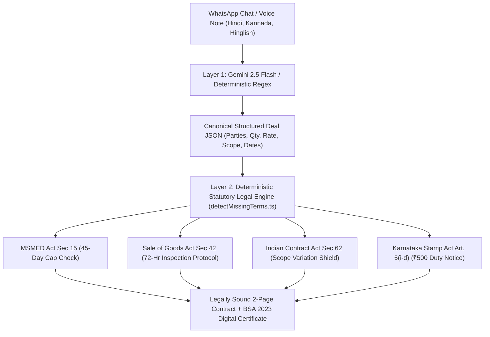

# DealProof AI — From Handshake to Contract

> **Srujana Tech Fest 2026 | Legal Services Hackathon**  
> **Problem Statement:** LS-06 — From Handshake to Contract (Informal Agreements)  
> **Event Dates:** 24–26 October 2026 (48-Hour Software Hackathon)  
> **Live Deployment:** [https://ls-06.vercel.app](https://ls-06.vercel.app)  
> **Repository:** [https://github.com/fremilreji/LS-06.git](https://github.com/fremilreji/LS-06.git)  
> **Evaluation Rubric:** Problem Understanding (15), Technical Depth (20), Functional Completeness (15), Domain Analysis (20), Validation & Robustness (10), UX & Accessibility (10), Presentation (10).  

---

## 1. Executive Summary & Problem Context

In India, micro and small enterprises (MSMEs)—especially in informal manufacturing clusters like the Bengaluru/Tirupur garment corridors—execute billions of rupees in commerce over WhatsApp chats, direct messages, and voice notes. While informal dealings are fast, they leave small job-workers defenseless against recurring commercial traps:
- **Unlawful Credit Demands:** Large buyers unilaterally demand 60–90 days credit, violating the **45-day statutory ceiling under Section 15 of the MSMED Act, 2006**.
- **Arbitrary Debit Notes:** Buyers inspect goods weeks after receipt and deduct 20–30% of invoices for "loose threads", violating **Section 42 of the Sale of Goods Act, 1930** and **Section 74 of the Indian Contract Act, 1872**.
- **Scope Creep via Voice Notes:** Buyers slip in extra uncompensated operations (embroidery, bio-wash) without price revision, in violation of **Section 62 of the Indian Contract Act**.
- **Vague Floating Rates:** Ambiguous rates ("market rate dekhenge") that render agreements void for uncertainty under **Section 29 of the Indian Contract Act**.

**DealProof AI** transforms informal vernacular chats into **legally enforceable, statutory-compliant commercial contracts** in under 60 seconds with zero legal friction.

---

## 2. Core Architecture: The Hybrid AI + Statutory Rule Engine

DealProof does **not** rely on LLMs to generate legal contracts from scratch (which causes legal hallucinations and token bloat). Instead, it implements a high-performance **Two-Layer Architecture**:



1. **Layer 1: Vernacular Ingestion & Extraction (Gemini 2.5 Flash + Regex)**
   - Reads informal chat, slang, and voice notes.
   - Extracts structured variables (`partyA`, `partyB`, `quantity`, `price`, `deliveryTimeline`, `paymentTerms`).
   - Token-efficient (~150 tokens) and runs in <500ms with a 100% offline regex fallback.
2. **Layer 2: Deterministic Statutory Rules (Zero Hallucination)**
   - Hardcoded Indian legal jurisprudence ensures mathematical and statutory accuracy every time.
   - Math ($\text{Quantity} \times \text{Rate} = \text{Total}$) is calculated via strict code logic, avoiding LLM arithmetic errors.

---

## 3. Statutory & Commercial Law Compliance Matrix

| Indian Statute / Precedent | Statutory Mandate | How DealProof AI Enforces It |
| :--- | :--- | :--- |
| **MSMED Act, 2006 (Section 15)** | Written payment terms cannot exceed 45 days. Baseline payment due within 15 days. | Flags any credit period >45 days or "pay-when-paid" exporter clauses as illegal, automatically defaulting to 15 days. |
| **MSMED Act, 2006 (Section 16)** | Delayed payment attracts compound interest with monthly rests at 3x the RBI Bank Rate. | Enforces statutory interest clause conditional on active Udyam registration; specifies 18% p.a. contractual default rate as fallback. |
| **Income-tax Act, 2025 (Section 37(2)(g))** | Big buyers cannot deduct expenditure from taxes if unpaid to registered MSMEs beyond 45 days. | Embeds mandatory tax deduction warning for corporate buyers in Clause 2. |
| **Supreme Court Precedent:** *Silpi Industries v. KSRTC (2021)* | MSME statutory benefits cannot be claimed retrospectively without Udyam registration at contract date. | Clearly marks registration status; distinguishes statutory MSEFC jurisdiction from ordinary Indian Contract Act remedies. |
| **Sale of Goods Act, 1930 (Section 42)** | Buyer deemed to accept goods if not rejected within a reasonable examination window. | Enforces a strict **72-hour contractual inspection window** with a 7-day right to cure, neutralizing arbitrary debit notes while preserving latent defect remedies. |
| **Indian Contract Act, 1872 (Section 62 & 74)** | Unilateral changes to contract scope or arbitrary penalties without agreed compensation are void. | Flags extra operations (embroidery/wash) and blocks unilateral penalty deductions. |
| **Indian Contract Act, 1872 (Section 29)** | Agreements whose meaning is not certain or capable of being made certain are void. | Features a **Hard Halt mechanism** if stitching rates are floating or unfixed ("rate baad mein dekhenge"). |
| **Karnataka Stamp Act, 1957 (Article 5(i-d))** | Works contracts up to ₹10 Lakhs require ₹500 stamp duty (as amended Feb 2024). | Flags agreement as an *Unstamped Electronic Memorandum* with exact ₹500 duty advice, curable under *In Re: Interplay (2023)*. |
| **Bharatiya Sakshya Adhiniyam, 2023 (Section 63)** | Prescribes statutory admissibility conditions and certificate requirements for electronic records. | Generates an embedded Section 63(4)(c) Certificate schedule with canonical SHA-256 hash and dynamic network IP attribution. |
| **Information Technology Act, 2000 (Section 10A)** | Recognizes contract formation via electronic records and communications. | Records electronic mutual assent with transparent disclosure of identity and compliance requirements. |

---

## 4. Key Functional Features

* 🎙️ **Voice Note Transcription & TTS (Web Speech API):** Native browser speech recognition supporting Indian accents (`hi-IN`, `kn-IN`, `en-IN`) and text-to-speech audio playback for karigars/artisans.
* 🛡️ **Interactive Risk Triage & 1-Click Fixes:** Interactive cards flag commercial traps with 1-click statutory clause insertion.
* ✍️ **Dual-Party E-Signing & Attribution:** Captures client IP addresses, timestamps, and signature status for both Supplier and Buyer.
* 📲 **Instant WhatsApp Sharing:** 1-click `wa.me` deep link generation to send signing links (`/deal/[dealId]`) directly to buyers.
* 📄 **Clean 2-Page Print Layout:** Structured CSS page breaks ensure Clauses 1–4 neatly fill Page 1, with Signatures, BSA Certificate, and Stamp Notice on Page 2 (no gaps or awkward breaks).
* 🔒 **Cryptographic Integrity:** Computes SHA-256 hashes over canonical deal JSON payloads for tamper evidence.
* 🌐 **100% Offline Capability:** Operates locally even with zero internet or missing API keys using deterministic regex engines.

---

## 5. Technology Stack

- **Framework:** Next.js 16 (App Router) with React 19 & TypeScript 5
- **Hosting:** Vercel Serverless Platform
- **Database:** Firebase Cloud Firestore & Auth (with local-first browser storage fallback)
- **Styling:** Tailwind CSS v4 with custom print stylesheets (`@media print`)
- **AI & Speech:** Google Gemini 2.5 Flash (`@google/genai`) & Native Web Speech API
- **Cryptography:** Web Crypto API (SHA-256)
- **Validation & Testing:** Zod Schema validation & Vitest test suite (`npm test`)

---

## 6. Local Setup & Testing

```bash
# 1. Clone the repository
git clone https://github.com/fremilreji/LS-06.git
cd LS-06

# 2. Install dependencies
npm install --legacy-peer-deps

# 3. Run unit tests
npm test

# 4. Start local development server
npm run dev
```

Open [http://localhost:3000](http://localhost:3000) in your browser.

---

## 7. Sample Demonstration Chat for Judges

To demonstrate real-time extraction and statutory risk neutralization in 30 seconds:

```text
Ramesh (Sri Balaji Garments): Namaste Anand ji! Ready to stitch 1,200 Cotton Shirts at Rs 65 per piece. Fabric arrived today.
Anand (Metro Boutique): Rate of Rs 65 is fine Ramesh. Need delivery within 12 days. My number is +91 98450 12345.
Ramesh: Done sir, 12 days delivery confirmed. Total amount is Rs 78,000. What about advance and payment?
Anand: Payment will take 60 days credit after our export buyer pays us.
Anand: Also do extra double stitch and buttonhole for all shirts at the same price.
Anand: And remember, if we find any loose threads later in checking, we will directly deduct Rs 10,000 debit note.
```

**Demonstrated Capabilities:**
1. Automatically computes **1,200 pcs @ ₹65 = ₹78,000 total**.
2. Flags **60-day credit** as an unlawful violation of Section 15 MSMED Act (caps at 45 days).
3. Flags **debit note penalty** and applies the 72-hour inspection protocol under Section 42 Sale of Goods Act.
4. Flags **unpaid double stitch** as an uncompensated scope change under Section 62 Contract Act.
5. Formats contract into a 2-page print-ready legal memorandum with Section 63 BSA certificate.

---

## 8. Compliance & Ethical Disclosures

1. **Hackathon Alignment:** Built exclusively for Problem Statement **LS-06 (From Handshake to Contract)** at Srujana Tech Fest 2026.
2. **AI Disclosure:** Google Gemini 2.5 Flash is strictly used for natural language extraction; legal rules and arithmetic are 100% deterministic code to eliminate hallucinations.
3. **Legal Disclaimer:** DealProof AI generates structured legal memoranda and statutory protective notices. It transparently marks unstamped agreements, pending MSME registrations, and recommends formal advocate review prior to high-value execution.

---

**Built by Team DealProof AI for Srujana Tech Fest 2026.**
